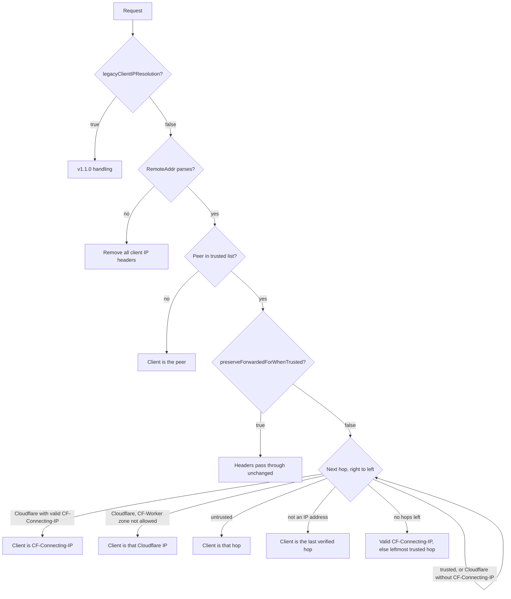

# Cloudflare Real-Client-IP Middleware

A Traefik middleware plugin that securely derives the **real client IP** when Cloudflare (or another trusted reverse proxy) sits in front of Traefik, or when clients connect directly. It prevents header spoofing and aligns **`X-Forwarded-For`** and **`X-Real-IP`** so downstream middlewares such as `ipAllowList` see one consistent address.

## What Problem Does This Solve?

1. **IP spoofing**: Clients cannot choose their own IP by sending `X-Forwarded-For`, `CF-Connecting-IP`, `True-Client-IP` or `Forwarded`. Only hops that your trusted proxies vouch for are believed.
2. **Wrong “real IP” behind Cloudflare**: Traefik may otherwise treat the last proxy hop as the client. This plugin uses **`CF-Connecting-IP`** when the request demonstrably came through Cloudflare, also when your own load balancer sits between Cloudflare and Traefik.
3. **`ipAllowList` / `depth: 1`**: After normalization, `X-Forwarded-For` holds exactly one address, the resolved client IP, so allow/deny rules match the real client.

## How It Works

The plugin decides per request, based on the **TCP peer** (`RemoteAddr`, the address that opened the connection to Traefik).



### Untrusted peer

The peer is the client. Whatever the client sent is discarded:

- `X-Forwarded-For` and `X-Real-IP` (and the legacy [`header`](#header), if it names another header) are set to the peer address.
- `CF-Connecting-IP`, `CF-Connecting-IPv6`, `True-Client-IP` and `Forwarded` are removed.

### Trusted peer

The plugin walks the hops from right to left: first the TCP peer, then every `X-Forwarded-For` entry from right to left. Multiple `X-Forwarded-For` header lines are joined in order. Entries with a port (`192.0.2.1:5678`, `[2001:db8::1]:443`, as written by Azure Application Gateway, for example) are accepted.

1. A **Cloudflare** hop with a valid `CF-Connecting-IP` ends the walk: the client is `CF-Connecting-IP`.
2. A **trusted** hop, or a Cloudflare hop without a valid `CF-Connecting-IP`, is skipped.
3. The first **untrusted** hop is the client. This is the address the rightmost trusted proxy saw.
4. An entry that is **not an IP address** (for example `unknown`) stops the walk: the client is the last verified hop, which is the trusted proxy that appended the entry.
5. If **every** hop is trusted, a valid `CF-Connecting-IP` is the client; otherwise the leftmost trusted hop is.

A hop counts as Cloudflare when its address is in the [Cloudflare list](#trusted-list-and-cloudflare-list). A Cloudflare address inside `X-Forwarded-For` counts too, because a trusted proxy appended it. That is what keeps **Cloudflare → load balancer → Traefik** working even when only the load balancer is in `trustedProxyRanges`.

If [`allowedWorkerZones`](#allowedworkerzones) is set and the request carries a `CF-Worker` header naming a zone outside that list, a Cloudflare hop resolves to the Cloudflare address itself instead of `CF-Connecting-IP`.

Then the headers are rewritten:

- `X-Forwarded-For` and `X-Real-IP` are set to the client.
- `True-Client-IP`, if present, is set to the client.
- When the client did **not** come from `CF-Connecting-IP`: `CF-Connecting-IP`, if present, is set to the client and `CF-Connecting-IPv6` is removed.
- The legacy [`header`](#header) is set to the client last.
- `Forwarded` is left as it is.

With [`preserveForwardedForWhenTrusted: true`](#preserveforwardedforwhentrusted), requests from trusted peers pass through unchanged instead.

### Unparseable peer address

If `RemoteAddr` is not an IP address (for example a link-local IPv6 address with a zone such as `[fe80::1%eth0]:5555`), the plugin cannot tell who connected. It removes `X-Forwarded-For`, `X-Real-IP`, `CF-Connecting-IP`, `CF-Connecting-IPv6`, `True-Client-IP`, `Forwarded` and the legacy `header`.

### Trusted list and Cloudflare list

The plugin keeps two lists:

- The **trusted list** decides which TCP peers and which `X-Forwarded-For` entries are trusted proxies. It contains `trustedProxyRanges`, plus Cloudflare’s ranges when `fetchCloudflareRanges: true` (the fetched list, or the embedded snapshot when the fetch fails and is not required).
- The **Cloudflare list** only recognizes Cloudflare hops. It is the fetched list when `fetchCloudflareRanges: true` and the fetch succeeded, otherwise a snapshot of Cloudflare’s ranges embedded in the plugin. It never adds anything to the trusted list: with `fetchCloudflareRanges` off, a Cloudflare **peer** is trusted only if its range is in `trustedProxyRanges`.

The Cloudflare ranges are read when Traefik creates the middleware (at startup and on dynamic configuration reloads), never per request. See [`fetchCloudflareRanges`](#fetchcloudflareranges) for caching and failure handling.

## Installation

### Traefik static config

```yaml
experimental:
  plugins:
    traefik_cloudflare_plugin:
      moduleName: github.com/danielbjornadal/traefik-cloudflare-plugin
      version: v1.2.0
```

Static configuration changes take effect when Traefik restarts.

### Local development

Traefik runs plugins from source with its embedded Go interpreter (Yaegi); there is nothing to compile. To run a local checkout, place it under `plugins-local/src/<moduleName>` relative to Traefik’s working directory and declare it as a local plugin:

```bash
mkdir -p plugins-local/src/github.com/danielbjornadal
git clone https://github.com/danielbjornadal/traefik-cloudflare-plugin.git \
  plugins-local/src/github.com/danielbjornadal/traefik-cloudflare-plugin
```

```yaml
experimental:
  localPlugins:
    traefik_cloudflare_plugin:
      moduleName: github.com/danielbjornadal/traefik-cloudflare-plugin
```

Run the tests with `go test ./...` in the repository root.

## Configuration

### Recommended: fetch Cloudflare ranges + your own proxies

```yaml
apiVersion: traefik.io/v1alpha1
kind: Middleware
metadata:
  name: traefik-cloudflare-plugin
spec:
  plugin:
    traefik_cloudflare_plugin:
      fetchCloudflareRanges: true
      cloudflareRangesHTTPTimeout: 5s
      trustedProxyRanges:
        - 198.51.100.0/29
```

`198.51.100.0/29` stands for the addresses your own load balancer uses to connect to Traefik. Leave `trustedProxyRanges` empty if Cloudflare connects to Traefik directly.

### Fully static list (no HTTP fetch)

Omit `fetchCloudflareRanges` (or set it to `false`) and list Cloudflare’s ranges ([IPv4](https://www.cloudflare.com/ips-v4), [IPv6](https://www.cloudflare.com/ips-v6)) together with your own proxies under `trustedProxyRanges`. This is also the recommended setup when outbound HTTPS goes through a TLS-intercepting proxy (see [Security notes](#4-fetch-mode-trusts-the-cloudflare-api-response)).

### Configuration reference

All options are optional.

#### `trustedProxyRanges`

List of CIDRs or single IP addresses (IPv4 or IPv6) whose connections are trusted to carry client IP headers: Cloudflare (unless fetched) and your own load balancers or ingress proxies. An invalid entry makes the middleware fail to load. Ranges wider than IPv4 `/8` or IPv6 `/16` log a [warning](#startup-warnings). Default: empty, so every peer is untrusted unless `fetchCloudflareRanges` adds Cloudflare.

#### `fetchCloudflareRanges`

`true` loads Cloudflare’s ranges from `https://api.cloudflare.com/client/v4/ips` and adds them to the trusted list and the Cloudflare list. Default: `false`.

- The response must list only valid CIDRs, each IPv4 `/8` or narrower and IPv6 `/16` or narrower. A response that fails this check counts as a failed fetch. Redirects are refused.
- A successful fetch is reused by every router and reload in the same Traefik process for one hour.
- After a failed fetch, the API is not called again for one minute.
- When a refresh fails and an earlier fetch in the same process succeeded, the last good list is reused and a warning is logged once.
- When no fetched list is available, the plugin logs a warning and uses the embedded snapshot, or fails to load if `cloudflareRangesFetchRequired` is `true`.

#### `cloudflareRangesHTTPTimeout`

Timeout for the Cloudflare API request, as a Go duration (`5s`, `1500ms`). An invalid value makes the middleware fail to load. Default: `5s`.

#### `cloudflareRangesFetchRequired`

With `fetchCloudflareRanges: true`, `true` makes the middleware fail to load when no fetched list is available, instead of falling back to the embedded snapshot. A last good list from an earlier fetch in the same Traefik process satisfies this requirement. Default: `false`.

#### `preserveForwardedForWhenTrusted`

`true` passes requests from trusted peers through without touching any header (the v1.0.x behavior for trusted peers). Requests from untrusted peers are still normalized. Client IP headers from trusted peers are then not checked at all, so a [warning](#startup-warnings) is logged. Default: `false`.

#### `legacyClientIPResolution`

`true` runs the v1.1.0 request handling unchanged: from any trusted peer, a valid `CF-Connecting-IP` wins, otherwise the leftmost IP in the first `X-Forwarded-For` header line; when neither resolves, headers pass through unchanged. From untrusted peers, only `X-Forwarded-For`, `X-Real-IP` and the legacy `header` are set; other client IP headers are not removed. `allowedWorkerZones` has no effect in this mode. Clients can spoof their IP through any trusted proxy, so this is a temporary escape hatch for upgrades and logs a [warning](#startup-warnings). Default: `false`.

#### `allowedWorkerZones`

List of Cloudflare zone names (for example `example.com`) whose Workers may set `CF-Connecting-IP`. When set, a request whose `CF-Worker` header names any other zone (compared case-insensitively) resolves to the Cloudflare address instead of `CF-Connecting-IP`. Requests without a `CF-Worker` header are not affected. Default: empty, which disables the check. The check is opt-in because, once set, Workers on every zone you leave out lose `CF-Connecting-IP`, including Workers on your own zones if you forget to list them. See [Security notes](#3-trusting-cloudflare-means-trusting-every-cloudflare-customer).

#### `header`

Legacy option. When it names a header other than `X-Forwarded-For` or `X-Real-IP` (for example `True-Client-IP`), that header is also set to the resolved client IP, and removed when the peer address cannot be parsed. Default: `X-Forwarded-For`.

#### `directRanges`

Accepted for compatibility with older configurations and ignored. Entries must still be valid CIDRs or IP addresses, otherwise the middleware fails to load. Remove it from new configurations.

### Startup warnings

The plugin logs these warnings once per Traefik process. They never stop Traefik. Plugin log lines start with `traefik_cloudflare_plugin:`; Traefik 3.7 shows them at `ERR` level.

- `legacyClientIPResolution is enabled; client IP headers can be spoofed through trusted proxies`
- `preserveForwardedForWhenTrusted is enabled; client IP headers from trusted peers pass through unchecked`
- `trusted proxy range 0.0.0.0/0 is very broad; every client inside it can set client IP headers` (for any trusted range wider than IPv4 `/8` or IPv6 `/16`)
- `cloudflare ranges refresh failed, using list fetched at <time>: <error>`

When a fetch fails without a last good list, `cloudflare ranges fetch failed, using embedded snapshot: <error>` is logged each time the middleware is created.

One warning is logged on the first matching request instead of at startup, also once per process:

- `trusted proxy <ip> sent CF-Connecting-IP without X-Forwarded-For; add it to the entryPoint forwardedHeaders.trustedIPs and make it append X-Forwarded-For, otherwise clients connecting through it can set CF-Connecting-IP`

It means a trusted proxy that is not Cloudflare delivered a request with no `X-Forwarded-For`, so the plugin used the `CF-Connecting-IP` that proxy forwarded. That is correct when the proxy only receives traffic from Cloudflare. If clients can reach the proxy directly, they can choose that header. The usual cause is a proxy missing from the entrypoint's `forwardedHeaders.trustedIPs`, which makes Traefik remove `X-Forwarded-For` before the plugin runs.

## Usage

Attach this middleware **before** `ipAllowList` and any other middleware that reads client IP headers:

```yaml
apiVersion: traefik.io/v1alpha1
kind: IngressRoute
metadata:
  name: myapp
spec:
  entryPoints:
    - websecure
  routes:
    - match: Host(`example.com`)
      kind: Rule
      services:
        - name: myapp
          port: 80
      middlewares:
        - name: traefik-cloudflare-plugin
        - name: allowlist
```

### With IP allow list

Use **`ipStrategy.depth: 1`**. After this middleware, `X-Forwarded-For` holds a single entry, the resolved client IP.

```yaml
apiVersion: traefik.io/v1alpha1
kind: Middleware
metadata:
  name: allowlist
spec:
  ipAllowList:
    ipStrategy:
      depth: 1
    sourceRange:
      - 10.0.0.0/8
      - 192.168.0.0/16
```

## Upgrading to v1.2.0

**No configuration change is required.** Configurations written for v1.0.2 and v1.1.0 load unchanged. For the common setups (Cloudflare in front of Traefik, with or without your own load balancer in between, and clients connecting directly) the resolved client IP is the same as in v1.1.0. What changes is that client IP headers can no longer be forged through a trusted proxy.

To upgrade, set `version: v1.2.0` in the static configuration and restart Traefik. Then check the log for [startup warnings](#startup-warnings) and run the [verification](#verify-the-upgrade).

The sections below describe each topology. The examples use `203.0.113.9` for the visitor, `162.158.1.1` for a Cloudflare edge address and `198.51.100.2` for your load balancer (inside a trusted `198.51.100.0/29`).

### Cloudflare → Traefik

**What changes:** nothing for normal traffic. The client is `CF-Connecting-IP`, as before. `CF-Connecting-IP` and `CF-Connecting-IPv6` reach the backend unchanged.

**Action:** none, as long as Cloudflare’s ranges are in the trusted list (`fetchCloudflareRanges: true`, or Cloudflare’s ranges in `trustedProxyRanges`). That was already required in v1.1.0 to resolve the visitor. If Cloudflare is missing from the trusted list, Cloudflare is treated as an untrusted client: the client is the Cloudflare edge address, as in v1.1.0, and `CF-Connecting-IP`, `CF-Connecting-IPv6` and `True-Client-IP` are removed, whereas v1.1.0 passed them through.

**Verify:** request the site through Cloudflare; the backend sees your public IP in `X-Real-IP`.

### Cloudflare → your load balancer → Traefik

**What changes:** nothing. The client is `CF-Connecting-IP` whether the load balancer appends to `X-Forwarded-For` (`203.0.113.9, 162.158.1.1`), appends with a port (`162.158.1.1:443`), replaces it with its own address, or strips it, and whether only the load balancer or both the load balancer and Cloudflare are in the trusted list.

**Action:** none. Keep the load balancer in `trustedProxyRanges`. If only the load balancer is listed and `fetchCloudflareRanges` is off, Cloudflare hops are recognized with the embedded snapshot; consider `fetchCloudflareRanges: true` so ranges Cloudflare adds later are recognized too.

**Verify:** request the site through Cloudflare; the backend sees your public IP. Then send a forged `CF-Connecting-IP` to the load balancer directly (bypassing Cloudflare); with a load balancer that appends to `X-Forwarded-For`, the backend sees the address the load balancer saw, not the forged one. See [Your load balancer → Traefik, without Cloudflare](#your-load-balancer--traefik-without-cloudflare) for what the load balancer must do.

### Clients connecting directly to Traefik

**What changes:** `X-Forwarded-For` and `X-Real-IP` are the peer address, as before. Client-supplied `CF-Connecting-IP`, `CF-Connecting-IPv6`, `True-Client-IP` and `Forwarded` are removed; v1.1.0 passed them through. A backend that reads those headers sees them absent on direct traffic.

**Action:** only if a backend reads `CF-Connecting-IP`, `True-Client-IP` or `Forwarded` on direct traffic: make it fall back to `X-Real-IP`.

**Verify:** send `curl -H 'CF-Connecting-IP: 192.0.2.1' -H 'X-Forwarded-For: 192.0.2.1'` straight to Traefik; the backend sees your own IP and no `CF-Connecting-IP`.

### Your load balancer → Traefik, without Cloudflare

**What changes:**

- The client is the address the load balancer saw (the rightmost untrusted `X-Forwarded-For` entry), not the leftmost entry. In v1.1.0 a client could pick its IP by sending `X-Forwarded-For` or `CF-Connecting-IP`.
- Clients behind further proxies, such as a corporate proxy at `192.0.2.50`, resolve to that proxy’s address. In v1.1.0 they resolved to whatever the corporate proxy wrote into `X-Forwarded-For`.
- A `CF-Connecting-IP` sent through the load balancer is replaced by the resolved client, `CF-Connecting-IPv6` is removed, and an existing `True-Client-IP` is set to the resolved client.
- A request from the load balancer that carries no client information at all (no `X-Forwarded-For`, no valid `CF-Connecting-IP`, such as a health check) resolves to the load balancer’s address. v1.1.0 left the headers unchanged.

**Action:**

- Make sure the load balancer appends the connecting address to `X-Forwarded-For` (or replaces the header with it) and does not forward a client-supplied `CF-Connecting-IP` unchanged when it strips `X-Forwarded-For`.
- List the load balancer in the entrypoint’s `forwardedHeaders.trustedIPs` as well. Traefik removes `X-Forwarded-For` from peers outside that list before any middleware runs, and the plugin then sees only the load balancer.
- If allowlists depend on addresses behind a proxy you operate (for example a corporate proxy), add that proxy to `trustedProxyRanges` so the walk continues past it. Only do this for proxies that append the address they saw.

**Verify:** from a client behind the load balancer, send a forged `X-Forwarded-For: 192.0.2.1`; the backend sees the client’s real address.

### Proxies that write `unknown` or other non-addresses into X-Forwarded-For

**What changes:** when the walk reaches an entry that is not an IP address, it stops and the client is the trusted proxy to the right of that entry. For example, `X-Forwarded-For: 203.0.113.9, unknown` from the load balancer resolves to `198.51.100.2`. v1.1.0 took the leftmost parseable entry (`203.0.113.9`), or left the headers unchanged when none parsed.

**Action:** configure the trusted proxy that writes the entry to append the real connecting address instead. Entries written by untrusted proxies further left are never reached, because the walk stops at the first untrusted hop.

### Zones with Cloudflare’s “Remove visitor IP headers”

With this [Managed Transform](https://developers.cloudflare.com/rules/transform/managed-transforms/reference/#remove-visitor-ip-headers), Cloudflare sends no `CF-Connecting-IP`.

**What changes:** the client is the rightmost untrusted `X-Forwarded-For` entry, which is the address Cloudflare appended, or the Cloudflare edge address when `X-Forwarded-For` is empty. v1.1.0 used the leftmost entry, which the visitor controls.

**Action:** none.

### Backends that read CF-Connecting-IP on a path without Cloudflare

**What changes:** whenever the client was not taken from `CF-Connecting-IP`, an existing `CF-Connecting-IP` is overwritten with the resolved client and `CF-Connecting-IPv6` is removed. Backends see the resolved client instead of a value supplied by the client or an upstream proxy. On requests where the client came from `CF-Connecting-IP`, both headers reach the backend unchanged.

**Action:** read `X-Real-IP` in the backend. A trusted proxy of your own that strips `X-Forwarded-For` and sets `CF-Connecting-IP` keeps working: when every hop is trusted, a valid `CF-Connecting-IP` is the client.

### Configurations with preserveForwardedForWhenTrusted

**What changes:** requests from trusted peers still pass through unchanged. Requests from untrusted peers also lose `CF-Connecting-IP`, `CF-Connecting-IPv6`, `True-Client-IP` and `Forwarded`, as described under [Clients connecting directly to Traefik](#clients-connecting-directly-to-traefik). A [warning](#startup-warnings) is logged at startup.

**Action:** none required. Consider removing the option so trusted traffic is normalized too.

### Escape hatch: legacyClientIPResolution

If a setup breaks and you need time to adapt it, restore the v1.1.0 request handling while staying on v1.2.0:

```yaml
spec:
  plugin:
    traefik_cloudflare_plugin:
      legacyClientIPResolution: true
      # your other options unchanged
```

This brings back the spoofable behavior and logs a warning at startup. Treat it as temporary.

### Rollback

Pin the previous version in the static configuration and restart Traefik:

```yaml
experimental:
  plugins:
    traefik_cloudflare_plugin:
      moduleName: github.com/danielbjornadal/traefik-cloudflare-plugin
      version: v1.1.0
```

Remove `legacyClientIPResolution` and `allowedWorkerZones` from the middleware configuration when rolling back; v1.1.0 does not know them.

### Verify the upgrade

Deploy [`traefik/whoami`](https://github.com/traefik/whoami) behind the middleware; it echoes the request headers it receives:

```yaml
apiVersion: apps/v1
kind: Deployment
metadata:
  name: whoami
spec:
  replicas: 1
  selector:
    matchLabels:
      app: whoami
  template:
    metadata:
      labels:
        app: whoami
    spec:
      containers:
        - name: whoami
          image: traefik/whoami
          ports:
            - containerPort: 80
---
apiVersion: v1
kind: Service
metadata:
  name: whoami
spec:
  selector:
    app: whoami
  ports:
    - port: 80
---
apiVersion: traefik.io/v1alpha1
kind: IngressRoute
metadata:
  name: whoami
spec:
  entryPoints:
    - websecure
  routes:
    - match: Host(`whoami.example.com`)
      kind: Rule
      services:
        - name: whoami
          port: 80
      middlewares:
        - name: traefik-cloudflare-plugin
```

Find your public IP as Cloudflare sees it (use `-4` or `-6` consistently across the commands):

```bash
curl -s https://www.cloudflare.com/cdn-cgi/trace | grep '^ip='
```

**Direct, with forged headers.** Connect to Traefik (or your load balancer) without going through Cloudflare. Replace `<traefik-or-lb-ip>` with its public address:

```bash
curl -s --resolve whoami.example.com:443:<traefik-or-lb-ip> \
  -H 'CF-Connecting-IP: 192.0.2.1' \
  -H 'True-Client-IP: 192.0.2.1' \
  -H 'X-Forwarded-For: 192.0.2.1' \
  https://whoami.example.com/ | grep -iE '^(x-real-ip|x-forwarded-for|cf-connecting-ip|true-client-ip):'
```

Expected: `X-Real-Ip` and the first `X-Forwarded-For` entry show your own IP, never `192.0.2.1`. `CF-Connecting-IP` and `True-Client-IP` are absent when you reached Traefik directly, or show your own IP when you went through a trusted load balancer.

**Through Cloudflare, with a forged X-Forwarded-For:**

```bash
curl -s -H 'X-Forwarded-For: 192.0.2.1' https://whoami.example.com/ \
  | grep -iE '^(x-real-ip|x-forwarded-for|cf-connecting-ip):'
```

Expected: `X-Real-Ip`, the first `X-Forwarded-For` entry and `CF-Connecting-IP` show your real IP from the trace above.

Run both checks before and after the upgrade; for the topologies above marked “nothing changes”, the Cloudflare result is identical.

## Upgrading from v1.0.x to v1.1.0

v1.1.0 started normalizing headers for trusted peers. To keep the v1.0.x behavior (leave `X-Forwarded-For` unchanged when the peer is trusted), set:

```yaml
preserveForwardedForWhenTrusted: true
```

See [CHANGELOG.md](CHANGELOG.md) for details.

## Security notes

### 1. Headers are trusted only through trusted TCP peers

The plugin uses the **immediate TCP client** (`RemoteAddr`) to decide whether any client IP header may influence the resolved IP.

**Safe (typical Cloudflare path):** The connection to Traefik comes from `162.158.x.x` (a Cloudflare range in your trusted list). Cloudflare sets `CF-Connecting-IP: 203.0.113.5`. The plugin normalizes to `203.0.113.5`.

**Safe (typical direct path):** A browser connects from `198.51.100.10` (not in the trusted list). It may send `CF-Connecting-IP: 10.0.0.1` or a forged `X-Forwarded-For`; those are **discarded**. Headers are set to `198.51.100.10`.

**Middleware order:** This middleware must run **before** `ipAllowList` (or any rule that reads `X-Forwarded-For` / `X-Real-IP`). Otherwise another layer may trust spoofed headers first.

### 2. Keep trusted CIDRs minimal, and make sure trusted proxies append

Anyone who can open a TCP connection **from** an address inside your trusted list is treated like a real proxy.

**Risky:** `trustedProxyRanges: [0.0.0.0/0, ::/0]` (or an enormous corporate supernet attackers can reach) makes **every** client a trusted proxy, so a forged `X-Forwarded-For` or `CF-Connecting-IP` can impersonate any IP and **bypass an allowlist** that uses the normalized headers. The plugin logs a warning for such ranges.

**Better:** Cloudflare’s published ranges (via **`fetchCloudflareRanges`** or a static list) plus **only** the CIDRs of **your** load balancers or ingress that legitimately sit in front of Traefik (for example a small VIP range like `198.51.100.0/29`).

**Trusted proxies must append** the address they saw to `X-Forwarded-For` (or replace the header with it). A proxy that passes the client’s `X-Forwarded-For` through verbatim lets clients choose their IP. Such a proxy, and any proxy that strips `X-Forwarded-For`, must also not forward a client-supplied `CF-Connecting-IP`.

### 3. Trusting Cloudflare means trusting every Cloudflare customer

Cloudflare’s ranges carry traffic for every Cloudflare customer, not only your zones. Cloudflare [documents](https://developers.cloudflare.com/fundamentals/reference/http-headers/) that a Worker’s `fetch()` to a destination not proxied by Cloudflare controls `CF-Connecting-IP`. Anyone with a Cloudflare account can therefore reach an origin that accepts Cloudflare’s ranges with a `CF-Connecting-IP` of their choice. Requests that another zone’s Worker sends through **your** proxied hostnames cannot choose it: Cloudflare forces `CF-Connecting-IP` to a Cloudflare address on them.

Mitigations, strongest first:

- **[Authenticated Origin Pulls](https://developers.cloudflare.com/ssl/origin-configuration/authenticated-origin-pull/) with your own certificate** (zone-level or per-hostname, not Cloudflare’s shared certificate), enforced in Traefik with a `TLSOption` that requires a client certificate:

  ```yaml
  apiVersion: traefik.io/v1alpha1
  kind: TLSOption
  metadata:
    name: cloudflare-origin-pull
  spec:
    clientAuth:
      secretNames:
        - cloudflare-origin-pull-ca # Secret with the CA in ca.crt or tls.ca
      clientAuthType: RequireAndVerifyClientCert
  ```

  Reference it from the IngressRoute with `tls.options.name: cloudflare-origin-pull`.

- **[Cloudflare Tunnel](https://developers.cloudflare.com/cloudflare-one/networks/connectors/cloudflare-tunnel/)**, so Traefik accepts no connections from Cloudflare’s public ranges at all. Put the address `cloudflared` connects from in `trustedProxyRanges` instead of Cloudflare’s ranges.
- **`allowedWorkerZones`** listing your own zones. Worker subrequests carry a `CF-Worker` header naming the zone that owns the Worker; for any other zone the plugin resolves to the Cloudflare address instead of `CF-Connecting-IP`.

### 4. Fetch mode trusts the Cloudflare API response

With `fetchCloudflareRanges: true`, whatever `https://api.cloudflare.com/client/v4/ips` returns over HTTPS becomes trusted. The plugin validates the response (only CIDRs, nothing wider than IPv4 `/8` or IPv6 `/16`) and refuses redirects, but it relies on the TLS certificate check to know it is talking to Cloudflare. Behind an egress proxy that intercepts TLS, prefer a static list in `trustedProxyRanges`.

The fetch uses Go’s `net/http` only, with no extra modules, and runs when Traefik creates the middleware, not per request.

## FAQ

### Do I still need Traefik `forwardedHeaders.trustedIPs` if I use this plugin?

**Yes.** They are not obsolete.

| Mechanism                                                                   | Role                                                                                                                                                                                                                                            |
| --------------------------------------------------------------------------- | ----------------------------------------------------------------------------------------------------------------------------------------------------------------------------------------------------------------------------------------------- |
| **Entrypoint `forwardedHeaders.trustedIPs`** (e.g. on `websecure`)          | Traefik’s **own** HTTP layer: when the **TCP peer** is in this list, Traefik keeps incoming `X-Forwarded-*` / `X-Real-IP` headers for **access logs**, built-in client detection, and the middlewares that follow; otherwise it removes them. |
| **This plugin’s `trustedProxyRanges`** (+ optional `fetchCloudflareRanges`) | Your middleware: decides which hops in `X-Forwarded-For` and which `CF-Connecting-IP` values may set the **normalized** client IP for **`ipAllowList`** and backends.                                                                             |

The plugin does **not** reconfigure the entrypoint. Keep **`trustedIPs`** and the plugin’s trusted list **aligned** with the same real topology so Traefik core and your allowlists agree on who is a proxy. If a proxy is in the plugin’s list but not in `trustedIPs`, Traefik removes the `X-Forwarded-For` that proxy sent before the plugin can read it.

**Ideally they should list the same kind of addresses** (see below)—not identical YAML if one side uses fetch and the other is static, but the **meaning** should match.

### What should “trusted proxy” CIDRs contain?

These lists answer: _“Which **source IPs** (as seen by Traefik on the socket) belong to **infrastructure that is allowed to speak for the real client** via headers?”_

**Include:**

1. **Cloudflare** – All published egress ranges if traffic is **Client → Cloudflare → Traefik**. Use Cloudflare’s official lists or enable **`fetchCloudflareRanges`** in the plugin and mirror the same ranges in **`trustedIPs`** (static or generated).
2. **Your own reverse proxies / load balancers** – The CIDR(s) or single IPs from which **your** LB, ingress controller, or corporate proxy connects **to Traefik** (VIP subnet, node subnet as seen by the pod, health-check sources if they forward traffic—only if they actually proxy and append to `X-Forwarded-For` correctly).

Example (documentation-only range, not a real network): if your public LB always appears as `198.51.100.0/29` to Traefik pods, add that **in addition** to Cloudflare ranges.

**Do not include:**

1. **End-user / “local client” ranges** – Visitor home IPs, mobile networks, or “everyone in our company” are **not** trusted proxies. Putting huge public or RFC1918 ranges here because “our users are internal” makes **anyone** who can reach Traefik from those addresses able to **forge** `CF-Connecting-IP` / `X-Forwarded-For` and **bypass** an `ipAllowList` that trusts the normalized headers.
2. **`0.0.0.0/0` or `::/0`** – Never as “trusted proxy” unless you intend **every** TCP client to be treated as a trusted header source (effectively disabling spoofing protection).
3. **Arbitrary RFC1918 supernets** (e.g. all of `10.0.0.0/8`) – Only if **every** address in that range can **only** reach Traefik through **controlled** proxies you list separately; otherwise you widen who can spoof headers.

**Where “allowed clients” go:** Restrict **who may access the app** with **`ipAllowList`** (or similar) using **`sourceRange`** on the **normalized** client IP—**after** this middleware. That is separate from “who is a proxy.”

### Quick checklist

- **Trusted proxy lists** (Traefik `trustedIPs` + plugin `trustedProxyRanges` / fetch): Cloudflare (if used) + **narrow** CIDRs for **your** L7/L4 front ends.
- **Allowlist / denylist** (`ipAllowList`, firewalls, app logic): **Real client** IPs or networks you want to permit or block **after** normalization.

## Cloudflare IP ranges

- API used when **`fetchCloudflareRanges: true`**: [Cloudflare API /ips](https://api.cloudflare.com/client/v4/ips)
- Human-readable lists: [IPv4](https://www.cloudflare.com/ips-v4), [IPv6](https://www.cloudflare.com/ips-v6)

## License

Released under MIT License.

## Contributing

Contributions are welcome. Please open a Pull Request.

## Inspiration

Inspired by Traefik’s demo plugin pattern. See [Traefik Plugin Documentation](https://plugins.traefik.io/plugins/628c9ee2108ecc83915d7764/demo-plugin).
